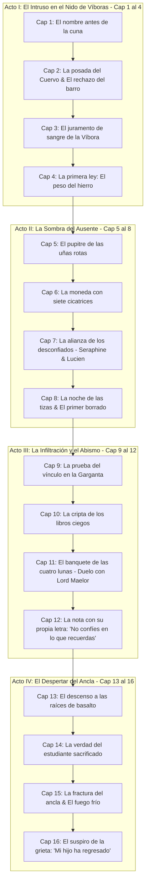

# Plan Maestro de Extensión, Misterio y Aventura: Libro I
## *El heredero de la serpiente* — 16 Capítulos Mayores (~140.000 palabras)

---

## 🧭 ¿Por qué este libro será extenso, adictivo y lleno de aventura?

El error común en la fantasía es creer que dosificar las revelaciones finales significa hacer un libro estático o aburrido. Todo lo contrario: **Patrick Rothfuss tardó casi 700 páginas en *El nombre del viento* solo para que Kvothe ingresara a los Archivos y sobreviviera a sus primeros semestres.**

El Libro I es un **thriller de misterio gótico, infiltración clandestina, magia de alto riesgo y supervivencia política**:
- **Tensión constante:** Lucien no solo asiste a clases; está a un paso de ser ejecutado o expulsado por entrar con una carta fraudulenta firmada hace 400 años.
- **Aventura y peligro físico:** Catacumbas olvidadas bajo la Garganta del Abismo, pruebas mágicas mortales donde un error de vínculo quema la carne o consume la mente, incursiones nocturnas y enfrentamientos con las "Sombras de la Deuda".
- **Intriga psicológica y romance espinoso:** Cada conversación con Seraphine es una partida de ajedrez donde una palabra en falso puede costarle la vida a cualquiera de los dos.

---

## 📜 Estructura de los 16 Capítulos (~8.500 - 10.000 palabras por capítulo)

---

## 🔍 Desglose Argumental Detallado (Capítulo por Capítulo)

### **Acto I: El Intruso en el Nido de Víboras (Cap. 1 - 4)**
1. **Capítulo 1: *El nombre antes de la cuna***  
   - Llegada a la Garganta del Abismo bajo la lluvia cenicienta.
   - Incidente del carruaje de la Casa Vael: primer choque dialéctico y medición de fuerzas con **Seraphine Vael**.
   - Lucien calcula los precios del cruce y llega a las puertas exteriores.
2. **Capítulo 2: *La posada del Cuervo***  
   - Lucien intenta pernoctar en la ciudad baja de Vhaldyr. Rescate de la gran escena de tu borrador: pronuncia su nombre y la posadera rompe la jarra de barro aterrorizada.
   - Comprende que «Lucien Veyr» no es un nombre anónimo; es una peste que la gente teme recordar.
3. **Capítulo 3: *El juramento de sangre de la Víbora***  
   - Ingreso nocturno al vestíbulo de la academia. Confrontación con la mesa de admisiones.
   - **Maese Odran Ardent** lo intercepta. Reconoce la firma del fundador en la carta de Lucien. En lugar de entregarlo a los verdugos, lo encierra en la Casa de la Víbora con una advertencia: *«Aquí aprendemos a callar; si abres la boca antes de saber mentir, aparecerás en el fondo del río»*.
4. **Capítulo 4: *La primera ley: El peso del hierro***  
   - Vida cotidiana en la Víbora. Conoce a **Tavian Orrel** (su compañero de cuarto, idealista y leal).
   - Primera clase del Arte del Vínculo con Ardent: Lucien experimenta el retroceso físico de la energía (la Segunda Ley: el coste). Lucien muestra un talento intuitivo inquietante que asusta a los profesores.

---

### **Acto II: La Sombra del Ausente (Cap. 5 - 8)**
5. **Capítulo 5: *El pupitre de las uñas rotas***  
   - En el aula magna de vinculación, Lucien descubre un pupitre desocupado con arañazos desesperados y un nombre raspado con navaja.
   - Pregunta a sus compañeros y profesores: nadie recuerda que alguien se haya sentado allí jamás. Sin embargo, hay polvo acumulado que delata una ausencia reciente.
6. **Capítulo 6: *La moneda con siete cicatrices***  
   - Lucien encuentra en su hatillo (o entre las pertenencias dejadas por su tutor Edrik) el artefacto central: la moneda de plata con un orificio en el centro y siete marcas grabadas.
   - Al tocarla bajo ciertas fases de luna, siente el eco térmico de una voz que le advierte: *«No confíes en la casa que te reclama»*.
7. **Capítulo 7: *La alianza de los desconfiados***  
   - Duelo dialéctico y académico con **Seraphine Vael** en los jardines de la Casa del Espejo.
   - Lucien descubre que Seraphine también está investigando una anomalía: el libro de contabilidad de su padre tiene pagos millonarios a una sección inexistente de Vhaldyr. Se reconocen como rivales indispensables.
8. **Capítulo 8: *La noche de las tizas***  
   - Se desata el primer incidente mnémico en los dormitorios: un novicio de la Llama amanece sin recordar a su familia y con marcas de tiza en la puerta: *«No abras»*.
   - Lucien se despierta con los nudillos manchados de hollín y encuentra en su bolsillo un trozo de papel con su propia letra: *«No confíes en lo que recuerdas»*.

---

### **Acto III: La Infiltración y el Abismo (Cap. 9 - 12)**
9. **Capítulo 9: *La prueba del vínculo en la Garganta***  
   - Examen de mitad de curso: los alumnos deben suspender cargas sobre el abismo de Vhaldyr mediante vínculos de contrapeso.
   - Sabotaje premeditado: alguien intenta que el vínculo de Lucien falle para que caiga al vacío. Lucien salva su vida transfiriendo el peso al puente con una agudeza letal, humillando a sus saboteadores.
10. **Capítulo 10: *La cripta de los libros ciegos***  
    - Lucien, Seraphine y **Mireya Sorn** se infiltran de noche en los archivos subterráneos de la Casa del Espejo.
    - Encuentran el tomo encuadernado en cuero negro de tu borrador: una lista de estudiantes borrados de la historia. El séptimo nombre es *Lucien Veyr*, fechado antes de su nacimiento con la palabra: *FALLECIDO*.
11. **Capítulo 11: *El banquete de las cuatro lunas***  
    - Evento político crucial en Vhaldyr: recepción oficial presidida por **Lord Maelor Vael**.
    - Lucien asiste como sirviente/acompañante de la Víbora; escucha las conversaciones secretas de las élites. Lord Maelor le clava la mirada y le hace una pregunta cargada de veneno sobre su linaje.
12. **Capítulo 12: *El eco del hombre sin sombra***  
    - De regreso a los dormitorios, Lucien es acorralado en los pasadizos por una silueta que no proyecta sombra en las paredes (el emisario de tu borrador).
    - La criatura no lo ataca físicamente; le habla de su madre Elara y le advierte que la academia lo está usando como cebo para mantener sellada la puerta inferior.

---

### **Acto IV: El Despertar del Ancla (Cap. 13 - 16)**
13. **Capítulo 13: *El descenso a las raíces de basalto***  
    - Lucien decide que no esperará a ser devorado por el sistema. Con la llave de hierro y la ayuda obligada de Seraphine, desciende más allá de las murallas hacia las galerías pre-fundacionales.
    - La atmósfera se vuelve claustrofóbica, con la misma opresión visceral del Prólogo.
14. **Capítulo 14: *La verdad del estudiante sacrificado***  
    - Llegan a la cámara oculta. Descubren el horror del sistema: el estudiante desaparecido del pupitre está atado a un mecanismo rúnico. Su mente y sus recuerdos están siendo drenados gota a gota para pagar la deuda mágica de las murallas de Vhaldyr.
    - El sello de autorización lleva el blasón de la Casa Vael. Seraphine sufre la caída de su propia máscara: su familia es la carnicera de la escuela.
15. **Capítulo 15: *La fractura del ancla***  
    - Gran secuencia de acción y clímax: guardias y sombras intentan silenciarlos.
    - Tavian llega a socorrerlos. Lucien, acorralado, toma la decisión: no permitirá que sacrifiquen al inocente. Usa la moneda con el agujero para desviar el flujo de deuda mágica y destruye el ancla de contención.
    - La cámara colapsa; la entidad subterránea despierta con un bramido sísmico.
16. **Capítulo 16: *El suspiro de la grieta***  
    - Consecuencias inmediatas: el estudiante es rescatado pero ha olvidado la mitad de su vida. Vhaldyr se cubre de neblina y los maestros entran en pánico sin entender por qué las murallas han dejado de ser indestructibles.
    - Seraphine y Lucien sellan su pacto en el pretil del puente: ninguno de los dos volverá a ser el mismo; son cómplices del mayor secreto del reino.
    - **Gancho final hacia el Libro II:** A solas en su cuarto, Lucien observa la moneda de plata. Una de las siete líneas se tiñe de carmesí brillante, y desde el fondo del abismo le llega un susurro que hiela la sangre: *«—Por fin... mi hijo ha regresado»*.
