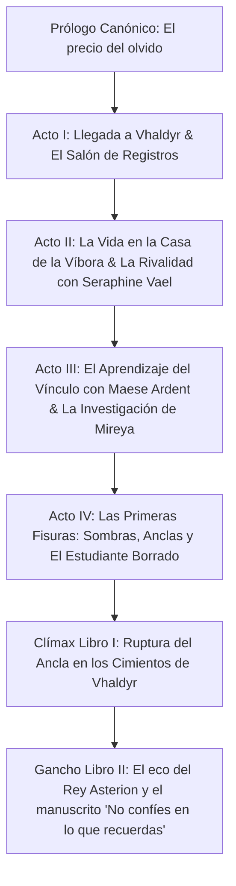

# Auditoría Integral: Análisis de Incongruencias y Propuesta Estructural
## Proyecto: *Las crónicas del juramento roto* — Libro I

---

## 🛑 PARTE 1: La Gran Incongruencia (Borrador Antiguo vs. Biblia Narrativa & Prólogo)

Al analizar las 169 páginas de tu borrador contra la **Biblia Narrativa de la Saga de 7 Libros** y el **Prólogo Canónico**, salta a la vista un problema crítico de concepción:

### 1. El borrador cierra en el Libro 1 lo que era el clímax de toda la saga de 7 libros
- **En tu Biblia de 7 libros:**
  - El Libro 1 es la entrada a la academia, el misterio íntimo de un alumno desaparecido, las conspiraciones académicas y políticas entre las casas, y el descubrimiento de que Lucien figura antes de nacer.
  - La Corona de Ceniza se descubre y destruye en el **Libro 4**.
  - La verdad de los Fundadores y la manipulación mnémica se destapa entre los **Libros 2, 5 y 6**.
  - La renuncia a la memoria y la elección final de restaurar la deuda mágica es el **Clímax del Libro 7**.
- **En tu borrador antiguo (Capítulos I al XII):**
  - Lucien llega a la academia en el Cap I, e inmediatamente en el Cap II entra en un armario mágico, viaja a mundos oníricos, se enfrenta al Rey Asterion en el cielo (Cap VI), desata el fin del mundo y en el Cap XII **ya ha resuelto toda la verdad cósmica, destruido la corona, liberado a Edrath y se marcha de Vhaldyr**.
  - **Consecuencia dramática:** Si esto pasa en el Libro 1, **la saga de 7 libros deja de existir**. Se queman todas las cartas en 12 capítulos cortos sin dar tiempo a que Vhaldyr funcione como academia, sin intriga política y sin desarrollo de personajes.

### 2. Personajes ausentes y personajes duplicados
- **¿Dónde están Seraphine, Tavian y Mireya?**
  - En la Biblia Narrativa, la rival y coprotagonista es **Seraphine Vael** (Casa del Espejo), el idealista es **Tavian Orrel** y la investigadora es **Mireya Sorn**.
  - En el borrador antiguo, Seraphine no existe; en su lugar hay una consejera llamada **Seris** (que parece adulta) y una ladronzuela/estudiante llamada **Mara** que actúa como Deus Ex Machina sacando horquillas y conociendo todos los pasadizos secretos de la ciudad. Tavian y Mireya ni siquiera aparecen.
- **Edrik vs. Ordan:**
  - En el borrador antiguo, Edrik es un tutor campesino que muere al inicio y luego su fantasma persigue a Lucien. Pero en la Biblia, el mentor de la academia es Maese Odran Ardent.

### 3. Falta del Sistema de Magia (El Arte del Vínculo)
- En tu Biblia creaste un sistema mágico fascinante: **Las 5 Leyes del Vínculo** (Semejanza, Coste, Resistencia, Permanencia y Deuda), donde la memoria es la divisa transaccional.
- En el borrador antiguo, la magia es casi "Alicia en el País de las Maravillas": armarios que dan a pasillos oscuros, sombras con coronas, monstruos sin cara, puertas que sangran y campanas mágicas. No hay uso de la magia por parte de Lucien; todo le ocurre a él de forma pasiva.

### 4. Problemas de Prosa y Redacción (Frente al listón del Prólogo)
- **Diálogos de ping-pong:** El borrador tiene cientos de líneas vacías de réplica inmediata:
  > —No lo sé.  
  > —¿Por qué?  
  > —Porque sí.  
  > —¿Y qué significa?  
  > —Significa problemas.
- **Falta de densidad sensorial:** Frente al aroma a pan, lluvia, estiércol, sangre seca y la pesadez de la piedra del Prólogo, el borrador abusa de frases genéricas ("Lucien sintió un escalofrío", "la habitación se inclinó", "suspiró").

---

## 🛠️ PARTE 2: El Plan de Rescate y Reestructuración Argumental

Para que este primer libro tenga la talla del Prólogo y sostenga la saga de 7 libros, reordenamos los elementos del borrador dentro de la arquitectura canónica:

### Elementos rescatados del borrador antiguo (pero ahora dosificados con maestría):
1. **El Registro de los Muertos y la firma tachada:** No ocurre en una pesadilla inmediata la primera noche; es un descubrimiento clandestino en los archivos subterráneos junto a Mireya y Seraphine.
2. **La sombra del Rey Asterion y la moneda de deuda:** La moneda de deuda es un artefacto físico real que Lucien custodia en secreto, entregada bajo cuerda por Maese Ardent o encontrada entre los legajos antiguos, pero su deuda se paga gota a gota, no rompiendo el cielo en el capítulo 6.
3. **La voz en el subsuelo:** El suspiro de la grieta que vimos en el Prólogo («—Por fin») conecta con las perturbaciones en los sótanos de la academia donde Lucien siente que las piedras lo llaman por un nombre que él desconoce.
4. **Fusión y orden de personajes:**
   - La presencia femenina principal y rival intelectual es **Seraphine Vael** (absorbiendo la agudeza que tenía Seris/Mara, pero con porte patricio y conflicto dinástico).
   - **Tavian Orrel** acompaña a Lucien en el día a día para darle un contrapunto ético.
   - **Maese Odran Ardent** es el tutor que sabe demasiado y dosifica el veneno de la verdad.
